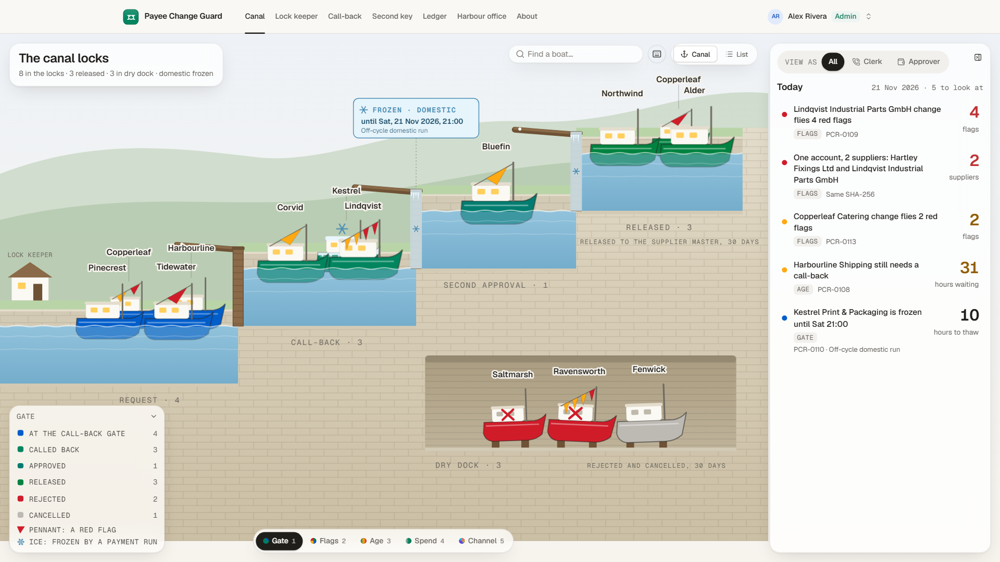

# Payee Change Guard

Every change to a supplier's bank details rises through three gates before anyone pays into it: a **request** with
the source document, a **call-back** on the phone number already on file, and **approval by a different person**.
Changes freeze before each payment run, red-flag patterns (an account already used by another supplier, urgency,
email, a new bank country…) are raised as you type, and the app never stores a full account number: only a masked form
and a SHA-256 fingerprint.




## This repository

```text
apps/payee-change-guard/   the app: React + Vite frontend, Rayfin data model (rayfin/), tests, demo walkthrough
shared/         shared package (@x10/shared): data store, sign-in runtime, UI kit, charts
tools/          deploy, seed, SQL and secrets-check scripts
```

Quick start (no Fabric tenant needed, runs in demo mode with sample data):

```bash
npm install
npm run dev
```

## The problem

Business email compromise and vendor impersonation fraud cost organisations billions every year. A fraudster posing
as a supplier asks for the bank details to be updated, a clerk changes them, and the next payment run pays the
criminal. The control that stops it is simple and routinely skipped: **call the supplier back on a number already on
file, and have a second person approve.** This app makes that control the only way a change gets through, and leaves
a ledger an auditor can read.

It supports your payment-controls process; it does not move money, change your ERP, or replace finance, audit or legal
judgement (the About page says so).

## What it looks like

**The canal locks.** A side-on lock flight rises left to right through three chambers named after the gates (Request,
Call-back, Second approval) to the **Released** basin. Every open change is a boat in the chamber of the gate it has
reached, flying its red flags as pennants; boat length is the supplier's annual spend. When a gate opens (a confirmed
call-back, an approval, a release) the boat glides to the gate, rises with the water and sails into the next chamber;
rejected and cancelled boats are lifted out into the **dry dock**. A payment-run freeze puts ice on the second-key and
release gates and on the boats it holds, and a sign on the second key gives the exact time the gate opens again.
Changes made on another screen, or by someone else (polled every 5 s), play as movement when you come back.

- **Lenses** (keys 1–5): gate, flags, age, spend, channel. Each re-paints the hulls; the legend counts each group.
- **View as** (V): all, clerk, approver. What that role cannot act on steps back, and **Today** re-ranks the three to
  five things that need attention (the four-flag change, an account shared by two suppliers, a call-back waiting more
  than 24 h, an approval held by the freeze, a change ready for the second key). Each item flies to its boat and
  switches to its lens.
- **Tools, named in the metaphor:**
  - **Lock keeper**: the request form. Supplier search, new account with live masking (only `•••• 1234` and the
    SHA-256 fingerprint are kept), and the flags hoisted on a preview boat as you type.
  - **Call-back**: the queue at the first gate and a call sheet that shows **only the number on file** (never a number
    from the request), checks the number you dialled as you type, and records the outcome.
  - **Second key**: the approval desk: old and new masked account, every flag with its reason, the call-back evidence,
    the freeze, and an override reason when two or more flags are up.
  - **Voyage log**: one change through its gates, with release (custodian only) and cancel.
  - **Ledger**: every supplier's history, CSV export (masked accounts only).
  - **Harbour office** (admins): the payment-run calendar, the supplier master and who holds which key.
- **Fallbacks:** the canal is SVG (no WebGL needed; `?nowebgl` shows the same canal), **L** switches to an accessible
  list of the same requests, reduced motion stops the water, bobbing, pennants and voyages, `?` lists the shortcuts,
  and phones pan along the canal. Screens for every page, both themes, desktop and phone: [docs/redesign](apps/payee-change-guard/docs/redesign).

## Prerequisites

- A Fabric tenant with the **Fabric Apps** workload enabled.
- A workspace on a Fabric capacity, and **Edit** (Contributor or higher) permission on it to deploy.
- Node.js 20 or later.
- Users need access to the app item (workspace members get it by default). SQL-only app, authenticated access only:
  no connector, no anonymous data access, no extra tenant setting.

## Run locally

```bash
npm install            # once, at the repository root
cd apps/payee-change-guard
npm run dev            # offline demo on http://localhost:5216 with seed data and a persona switcher
npm run dev:fabric     # rayfin dev: the real Rayfin backend and Fabric sign-in
SCREENSHOTS=1 npx playwright test e2e/screenshots.spec.ts   # rewrite docs/redesign/*.png
```

Demo personas (switch in the identity menu, or open with `?as=<sub>`):

| Persona | Sub | Role |
|---|---|---|
| Alex Rivera | `demo-admin-alex` | Admin: supplier master and payment runs, custodian of every supplier, holds a second key |
| Sam Taylor | `demo-clerk-sam` | AP clerk; raised most seeded requests (try separation of duties as Sam) |
| Priya Nair | `demo-clerk-priya` | AP clerk; made most seeded call-backs |
| Jordan Lee | `demo-controller-jordan` | Finance controller: the second key |

## Deploy

```bash
npx rayfin login
npx rayfin up --workspace-id <workspace-id>
```

`rayfin up` builds the app (`build:fabric`), deploys it and applies the schema. Check health with `npx rayfin up status`.

## Seed and making an admin

```bash
npm run seed:fabric -- --admin-email you@org.com
```

Inserts the demo data (skipped if the `seed:v1` marker exists), with dates relative to the moment you seed:

- **24 fictional suppliers** (one blocked), with invented accounts stored masked and hashed.
- **14 change requests** in every state: 4 at the call-back gate (one waiting 31 h, one after a no-answer call, one
  with two flags after a change 9 days earlier and a phone change 12 days ago), 3 called back (the **four-flag**
  Lindqvist change: email, urgency, new bank country and an account already on file for Hartley Fixings; one frozen
  before tomorrow's domestic run; one ready to approve), 1 approved and waiting for release, 3 released (one last
  week), 2 rejected (one by a **denied call-back**) and 1 cancelled. Call-backs for all of them, including a call to
  the number in an email signature that could not verify.
- **Payment runs** on Tuesdays and Fridays for domestic suppliers, plus an off-cycle domestic run tomorrow when
  tomorrow is neither (so a freeze is always on show), and a weekly international run four days out.
- Keys: Sam and Priya are clerks, Jordan and Alex hold the second key (granted by Alex, the admin).

The script maps the **first persona** (Alex Rivera) to the admin account you name: you become the custodian of the
seeded suppliers and the creator of the seeded runs, so you can edit and release under the row policies. Open the
deployed app once **before** seeding so your Person row exists; the script also sets you as admin. By hand:

```sql
UPDATE dbo.People SET isAdmin = 1 WHERE email = 'you@org.com';
```

Grant the clerk and approver keys to real colleagues in **Harbour office → Keys**.

## How it works

### Entities

| Entity | Purpose | Key fields |
|---|---|---|
| `Supplier` | The supplier master with the account on file | name (3–150), supplierNo (≤20), phoneOnFile (5–40), phoneOnFileSince, country, currentAccountMasked (≤34), currentAccountHash (64), currentBankCountry, annualSpend?, status (`active`/`blocked`), payGroup (`domestic`/`international`), custodianSub |
| `ChangeRequest` | One change: the boat | ref, supplierId, requestedBy, requestedAt, channel (`email`, `letter`, `portal`, `phone`, `in_person`), sourceRef (3–200), newAccountMasked, newAccountHash, newBankCountry, reason (10–600), urgencyClaimed, status (`requested`, `verified`, `approved`, `rejected`, `released`, `cancelled`), flags (codes, ≤300), verifiedBy/At, approvedBy/At, overrideReason?, releasedAt, rejectReason?, closedBy/At |
| `Callback` | One call-back attempt, append-only | requestId, requesterSub (copied from the request), calledBy, calledAt, numberUsed, numberMatchesFile, contactName, outcome (`confirmed`, `denied`, `no_answer`), note? |
| `PaymentRun` | The calendar that freezes the gates | runDate, freezeHours (int), label, payGroup (`all`, `domestic`, `international`), createdBy |
| `StaffRole` | Who holds which key | personSub, personName, role (`clerk`, `approver`), grantedBy, grantedAt |
| `Person`, `AppMarker` | Shared identity and seed marker | as generated |

Two additions to the spec's entities: `payGroup` on suppliers and runs (a run freezes only the suppliers it pays, as
ERP pay groups do; without it a twice-weekly calendar would freeze every approval most of the week), and the owner
columns `custodianSub`, `createdBy`, `grantedBy`, `requesterSub` and `closedBy/At` so the row policies have something
to check.

### Rules (pure functions in `src/domain/`, thresholds in `src/config.ts`, all unit-tested)

1. **Gate order** (`gates.ts`): requested → verified → approved → released. Verified needs a call-back with outcome
   *confirmed* **and** the number dialled equal to the supplier's phone on file (compared by digits). A **denied**
   call-back rejects the request automatically; *no answer*, or a confirmed call on any other number, is logged and
   changes nothing.
2. **Separation of duties**: verifier ≠ requester; approver ≠ requester and ≠ verifier; approvers are `approver` key
   holders or admins. Release is by the supplier's custodian (an admin), never the requester.
3. **Freeze** (`freeze.ts`): no approval or release within `freezeHours` (48 by default) before a payment run for the
   supplier's pay group. Overlapping windows merge, so "frozen until" is the moment the gate really opens.
4. **Red flags** (`flags.ts`), each with a reason: urgency claimed; bank country differs from supplier country; a bank
   country never used for this supplier; requested by email; phone on file changed in the last 30 days; the new
   account's hash already held (or pending) for a different supplier; annual spend above 250,000; a change within 14
   days of a previous one. **Two or more flags** need a written override reason (at least 20 characters) to approve.
   Flags are stored when the request is made and re-checked live at the second key.
5. **Release** writes the masked account, hash and bank country to the supplier, and nothing else.
6. **Account numbers** (`account.ts`): the full number exists only in the form field. The app masks it
   (`•••• 1234`), computes SHA-256 in the browser (pure TypeScript, tested against the FIPS 180-4 vectors and the
   platform's SubtleCrypto) over the normalised number, and stores masked + hash only. A unit test creates a request
   and checks the whole store; a Playwright test checks the browser's storage.
7. **Trail check** (`integrity.ts`): every request past a gate must be backed by its evidence (a confirmed call on the
   number on file by the recorded verifier; approver ≠ requester/verifier; an override when flags ≥ 2). A mismatch
   leaks on the canal and shows in Today.

### Security model

| Entity | read | create | update | delete |
|---|---|---|---|---|
| ChangeRequest | everyone signed in | `requestedBy = claims.sub` **and** `status = 'requested'`; gate fields excluded | `claims.sub ≠ requestedBy` **and** status not `released`, `rejected` or `cancelled`; everything the requester wrote (supplier, account, channel, source, reason, flags…) excluded | nobody |
| Callback | everyone | `calledBy = claims.sub` **and** `claims.sub ≠ requesterSub` | nobody | nobody |
| Supplier | everyone | `custodianSub = claims.sub` | `custodianSub = claims.sub` | nobody |
| PaymentRun | everyone | `createdBy = claims.sub` | same | same |
| StaffRole | everyone | `grantedBy = claims.sub` | same | same |
| Person / AppMarker | as generated (isAdmin never writable from the client) | | | |

Enforced **by the database**: the requester can never update their own request (so cannot verify, approve, release or
reopen it) and can never record a call-back on it; requests are created only as yourself and only at the first gate;
nobody can rewrite the account, supplier or flags of a request after it is raised; closed requests are frozen; call-
backs cannot be forged in someone else's name, edited or deleted; only a supplier's custodian can change the master
(including the phone on file and the current account).

Enforced **in the domain** (`src/domain/*.ts`, both in demo mode and in Fabric): verifier ≠ approver, the approver
role, the call-back number check, the freeze, the override reason, admin-only master and calendar edits, and that a
role row counts only when an admin granted it. `src/domain/policies.ts` mirrors the row policies, and
`policyStore.testutil.ts` wraps the test store with them so the workflow tests prove every write the app makes is one
the database accepts (and that the database alone already stops the requester).

## Known limits

- **There is no admin claim**, so the database cannot tell an approver from a clerk. Any signed-in user other than the
  requester can update a request through the GraphQL API (for example set `status = 'approved'`). The app never does
  this without its checks, and the **trail check** flags any request whose status is not backed by a matching
  call-back and distinct people: the boat leaks on the canal and appears in Today. Full database-level enforcement
  would need dynamic auth claims (`udf.authClaims`), listed under Later.
- `numberMatchesFile` is written by the client; the trail check re-compares the dialled number with the master.
- A role row (`StaffRole`) can be written through the API by anyone as their own grantor; the app ignores rows not
  granted by an admin.
- The requester cannot cancel their own request (the update policy excludes them); an approver or admin cancels.
- Only one custodian per supplier can edit or release it; hand a supplier over by changing `custodianSub` in SQL.
- The SHA-256 fingerprint is unsalted so it can match the same account across suppliers. Account numbers are short,
  so the fingerprint can be brute-forced by someone with read access to the database: treat it as sensitive. A
  per-tenant secret (HMAC in a Function) is listed under Later.
- Everyone signed in can read the supplier master, requests and call-backs (masked accounts, phone numbers on file).
- The app records the control; it does not stop a payment in your ERP. Release reminds you to apply the change in
  the payment system; payment-file integration is listed under Later.

## Later

- Payment file integration: compare a payment run's file with released changes before it is sent.
- Supplier portal confirmations as a second channel for the call-back.
- ERP sync of the supplier master and the payment-run calendar.
- A keyed fingerprint (HMAC with a tenant secret in a Fabric Function) instead of a plain SHA-256.
- Database-level role enforcement with `udf.authClaims`.

## Gallery

**Title:** Birthday Bash: Payee Change Guard

**Blurb (80 words):** Stop supplier bank-detail fraud before the payment run. Every change to a supplier's bank account
rises through a canal of three lock gates: a request with its source document, a call-back on the number already on
file, and approval by a different person. Red flags such as an account already used by another supplier fly as
pennants, gates freeze before each payment run, and full account numbers are never stored, only a masked form and a
SHA-256 fingerprint.

**Tags:** Partner | Birthday Bash, Finance, Accounts payable, Fraud prevention, Internal controls, Segregation of duties, SQL database, Fabric Apps

## License

MIT. See [LICENSE](LICENSE).
